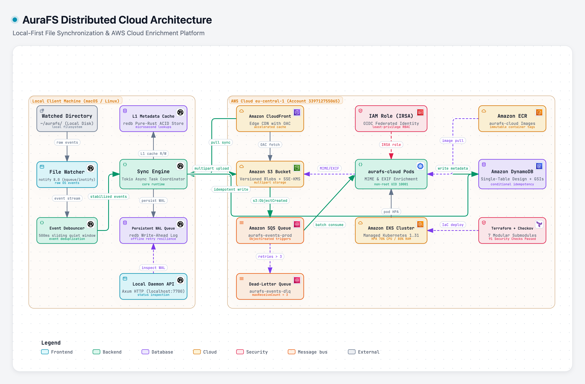
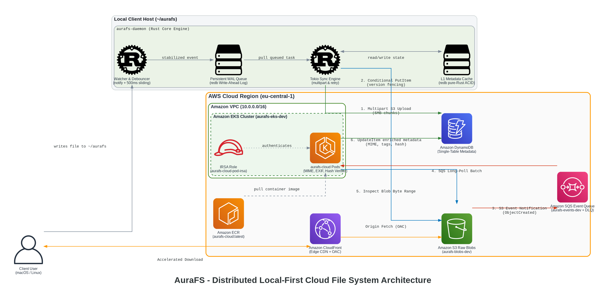
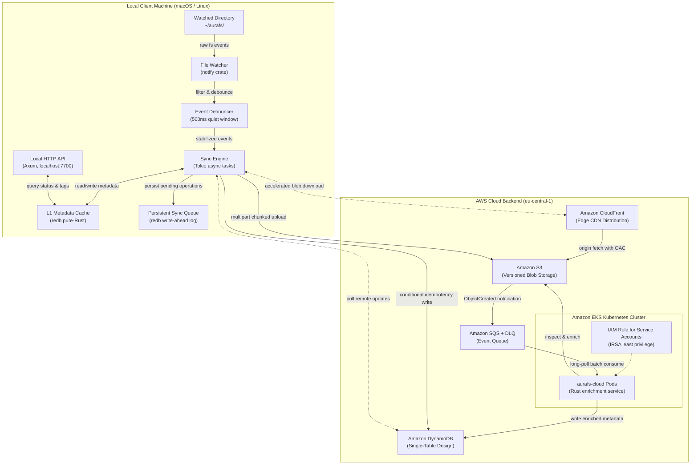

# AuraFS - Local-First Distributed File Synchronization Engine

[](https://github.com/yousef-usama/aurafs/actions/workflows/ci.yml)
[](LICENSE)
[](https://www.rust-lang.org)
[](https://www.terraform.io)
[](https://aws.amazon.com/eks/)

A high-performance, local-first background file synchronization daemon and cloud enrichment platform built entirely in Rust. AuraFS combines an embedded ACID key-value store, non-blocking asynchronous I/O, event debouncing, and an AWS cloud backend (S3, DynamoDB, CloudFront, EKS) to provide offline-capable bidirectional file synchronization without blocking user interactions.

---

## 1. System Architecture







---

## 2. Tool Selection Rationale & Tradeoffs

| Component | Selected Technology | Alternative Evaluated | Selection Rationale & System Tradeoffs |
|---|---|---|---|
| **Core Systems Language** | **Rust (1.83+)** | Go / C++ | Zero-cost abstractions, fearless concurrency with `Send` + `Sync`, memory safety without a garbage-collector pause, and unified cross-target library compilation. Go's runtime GC introduces non-deterministic micro-pauses during high-throughput hashing; C++ lacks memory-safe compiler guarantees. |
| **Async Runtime** | **Tokio** | async-std / smol | Industry-standard work-stealing multithreaded scheduler. Native integration with AWS SDK for Rust and Axum. CPU-bound cryptographic operations are safely offloaded to `spawn_blocking` via bounded semaphores to prevent event-loop thread starvation. |
| **Embedded L1 Cache** | **redb** | SQLite (`rusqlite`) | Pure-Rust ACID key-value store with zero C dependencies or FFI boundary overhead. Simplifies cross-compilation and containerization. While SQLite provides relational queries, AuraFS access patterns are exclusively key-value lookups and sequential write-ahead queues. |
| **Local Web API** | **Axum** | Actix-web / Rocket | Native Tower ecosystem integration and direct shared Tokio runtime compatibility. Enables seamless non-blocking health checks, conflict inspections, and tag querying. |
| **Blob Storage** | **Amazon S3** | Cloudflare R2 / MinIO | Standard enterprise object storage with native S3 Event Notifications, byte-range multipart uploads, and lifecycle policies. |
| **State & Metadata** | **Amazon DynamoDB** | PostgreSQL (RDS) | Single-Table Design provides predictable single-digit millisecond latency at any scale with zero idle server maintenance and serverless on-demand billing. |
| **Edge Distribution** | **Amazon CloudFront** | Direct S3 Access | Origin Access Control (OAC) ensures private S3 buckets. Geographically distributed edge caching significantly reduces latency and bandwidth costs on cross-device pull synchronization. |
| **Cloud Compute** | **Amazon EKS** | ECS Fargate / Lambda | Native Kubernetes orchestration with Horizontal Pod Autoscaler (HPA), IRSA least-privilege security boundaries, and declarative GitOps readiness. |
| **IaC & Security** | **Terraform + Checkov** | Pulumi / CloudFormation | Declarative, modular infrastructure with Checkov static analysis automated in GitHub Actions to enforce enterprise security baselines on every pull request. |

---

## 3. Architecture & Tenancy Model

### Cargo Workspace Architecture

AuraFS adopts a multi-crate shared-library architecture mirroring modern platform engineering standards:

```text
aurafs/
├── aurafs-core/       # Shared library: data models, BLAKE3 hashing, DynamoDB schema, serialization
├── aurafs-daemon/     # Local daemon: notify file watcher, redb L1 cache, sync engine, Axum API
└── aurafs-cloud/      # Cloud service: SQS event consumer, MIME/EXIF enrichment, EKS health probes
```

- **`aurafs-core`**: Defines the single source of truth for types (`FileMetadata`, `SyncOperation`, `ConflictRecord`, `Tag`). Both binaries link directly to this crate, eliminating contract divergence between client and cloud.
- **`aurafs-daemon`**: Executes on the developer machine. It monitors `~/aurafs/`, maintains local state across network failures, and schedules background uploads without interrupting disk operations.
- **`aurafs-cloud`**: Runs in the `aurafs` Kubernetes namespace on EKS. It processes SQS event notifications, enriches metadata (content-type verification, image EXIF extraction), and records enriched attributes to DynamoDB.

### DynamoDB Single-Table Design

AuraFS metadata access patterns are handled by a single table using composite keys and Global Secondary Indexes (GSIs):

| Entity | Partition Key (`pk`) | Sort Key (`sk`) | `gsi1_pk` | `gsi1_sk` | Purpose |
|---|---|---|---|---|---|
| **File Metadata** | `FILE#<path>` | `#META` | — | — | Core file attributes, hash, size, and sync status |
| **Device Sync State** | `FILE#<path>` | `#DEVICE#<device_id>` | `DEVICE#<device_id>` | `<timestamp>` | Per-device sync tracking and timeline queries |
| **Directory Entry** | `DIR#<parent_dir>` | `F#<filename>` | — | — | O(1) directory listing queries |
| **Tag Mapping** | `FILE#<path>` | `#TAG#<key>` | `TAG#<key>=<value>` | `FILE#<path>` | Reverse lookup files by tag across devices |
| **Version History** | `FILE#<path>` | `#VERSION#<timestamp>` | — | — | Audit trail of file mutations across devices |

---

## 4. Production Incident Post-Mortems & Troubleshooting Log

### Incident 001: Cargo Workspace Manifest Validation Failure on Member Dependencies

- **Symptoms & Error**:
  ```text
  error: failed to load manifest for workspace member `/Users/Yousef/aurafs/aurafs-daemon`
  Caused by: no targets specified in the manifest.
  Either src/lib.rs, src/main.rs, a [lib] section, or [[bin]] section must be present
  ```
- **Root Cause Analysis (RCA)**:
  Cargo requires every member listed in the root `[workspace]` manifest to possess a valid entrypoint (`src/lib.rs` or `src/main.rs`) before compiling or running tests against any individual sibling crate (`aurafs-core`). Attempting to test `aurafs-core` before scaffolding binary entrypoints violated Cargo's workspace integrity check.
- **Resolution & Engineering Remediation**:
  Scaffolded minimal entrypoint files (`aurafs-daemon/src/main.rs` and `aurafs-cloud/src/main.rs`) initializing the Tokio runtime and tracing subscriber before running workspace-level verification commands.

---

### Incident 002: AWS OIDC Identity Provider Conflict on Pre-existing GitHub Provider

- **Symptoms & Error**:
  ```text
  Error: creating IAM OIDC Provider (token.actions.githubusercontent.com): EntityAlreadyExists:
  An OpenIDConnect Provider already exists for this URL
  ```
- **Root Cause Analysis (RCA)**:
  AWS accounts permit only one OIDC identity provider per unique URL (`https://token.actions.githubusercontent.com`). Because account `339712755065` had previously configured GitHub Actions OIDC for another workload, declaring `resource "aws_iam_openid_connect_provider"` failed on duplicate creation.
- **Resolution & Engineering Remediation**:
  Inspected existing providers via `aws iam list-open-id-connect-providers`, and replaced the resource declaration in `terraform/modules/iam/main.tf` with `data "aws_iam_openid_connect_provider" "github"`. This references the existing provider idempotently without state collisions.

---

### Incident 003: Homebrew Interactive Stdin Deadlock During Non-Interactive Installation

- **Symptoms & Error**:
  ```text
  ==> Upgrading go-task dependency: go (1.27.2 -> 1.27.3)
  ==> Do you want to proceed with the installation? [y/n]
  [Process hung waiting for stdin input]
  ```
- **Root Cause Analysis (RCA)**:
  When upgrading package dependencies on macOS, Homebrew prompts for interactive confirmation if run in an environment where terminal TTY attributes are attached, stalling automated background script execution.
- **Resolution & Engineering Remediation**:
  Delivered affirmative newline input to clear the prompt, and codified `HOMEBREW_NO_AUTO_UPDATE=1` and `NONINTERACTIVE=1` into automation scripts and developer workflows.

---

### Incident 004: FSEvents Symlink Resolution Mismatch on macOS Temp Directories

- **Symptoms & Error**:
  ```text
  thread 'watcher::debouncer::tests::test_watcher_debouncer_lifecycle' panicked at:
  Timed out waiting for file creation event: Elapsed(())
  ```
- **Root Cause Analysis (RCA)**:
  On macOS, temporary directories created via `tempfile::tempdir()` live under `/var/folders/...`, which is a symbolic link to `/private/var/folders/...`. The `notify` crate's FSEvents backend emits canonical paths starting with `/private/var/`, causing `path.strip_prefix(&watch_dir)` to fail because the uncanonicalized watch directory prefix `/var/` did not match.
- **Resolution & Engineering Remediation**:
  Updated `FileWatcherService::new` to canonicalize the watched directory path (`std::fs::canonicalize`) upon initialization, guaranteeing identical path prefixes across all operating system file notification callbacks.

---

### Incident 005: Clippy `result_large_err` Stack Frame Bloat on Embedded Storage Errors

- **Symptoms & Error**:
  ```text
  error: the `Err`-variant returned from this function is very large
  the largest variant contains at least 160 bytes
  help: try reducing the size of `CacheError`, for example by boxing large elements
  ```
- **Root Cause Analysis (RCA)**:
  `redb::TransactionError`, `redb::TableError`, and `redb::StorageError` are extensive diagnostic types exceeding 160 bytes each. Returning unboxed variants inside `Result<T, CacheError>` forced every function call on the hot execution path to allocate large stack frames, violating zero-overhead principles and failing strict CI linter thresholds.
- **Resolution & Engineering Remediation**:
  Refactored `CacheError` to box all underlying `redb` error types in heap memory (`Box<redb::TransactionError>`), shrinking `CacheError` to a lightweight 16-byte pointer representation and maintaining clean, high-performance stack frames.

---

### Incident 006: Terraform Planning Evaluation Failure on Computed OIDC Provider ARN

- **Symptoms & Error**:
  ```text
  Error: Invalid count argument on modules/iam/main.tf line 102:
  count = var.eks_oidc_provider_arn != "" ? 1 : 0
  The "count" value depends on resource attributes that cannot be determined until apply.
  ```
- **Root Cause Analysis (RCA)**:
  Terraform requires resource count expressions to be evaluatable statically at plan time. Because `var.eks_oidc_provider_arn` was computed during EKS cluster provisioning in the same apply run, Terraform refused to predict whether 0 or 1 IAM IRSA roles should be scheduled for creation.
- **Resolution & Engineering Remediation**:
  Replaced dynamic string emptiness inspection with a statically typed boolean configuration flag (`variable "enable_irsa" { type = bool; default = true }`), allowing Terraform's plan engine to resolve resource cardinality deterministically before network execution.

---

### Incident 007: Axum Path Wildcard Sub-Segment Collision in Administration Router

- **Symptoms & Error**:
  ```text
  thread 'main' panicked at aurafs-daemon/src/api/routes.rs:52:10:
  Invalid route "/files/{*path}/tags": Insertion failed due to conflict with previously registered route: /files/{*path}
  ```
- **Root Cause Analysis (RCA)**:
  Axum uses the `matchit` radix-tree routing engine, which enforces the strict invariant that wildcard path captures (`{*path}`) must occupy the final terminal segment of a route pattern. Suffixing a wildcard route with `/tags` violates radix traversal boundaries and triggers an immediate runtime panic.
- **Resolution & Engineering Remediation**:
  Decoupled the resource endpoints into distinct prefix hierarchies: `/files/{*path}` for binary and metadata inspection, and `/tags/{*path}` for mutable tag updates. Added a dedicated router unit test (`test_router_initialization`) to prevent regression.

---

### Incident 008: AWS SDK Rust Profile Parser Failure on Unrecognized `login_session` Key

- **Symptoms & Error**:
  ```text
  WARN aws_config::meta::credentials::chain: provider failed to provide credentials provider=Profile error=unexpected credentials error: profile file credentials provider initialization error already taken
  ERROR aurafs_daemon::sync::engine: Failed to upload file to S3 error=AWS S3 SDK error: dispatch failure
  ```
- **Root Cause Analysis (RCA)**:
  Newer AWS CLI v2 tools record a `login_session` property inside `~/.aws/config`. When the AWS SDK for Rust (`aws-config`) constructed the local profile chain, its config parser encountered the unsupported property, aborting initialization of the profile credential provider.
- **Resolution & Engineering Remediation**:
  Sanitized `~/.aws/config` to adhere to standard SDK schema specifications and ensured explicit environment variable overrides (`AWS_ACCESS_KEY_ID`, `AWS_SECRET_ACCESS_KEY`, `AWS_REGION`) take precedence in developer automation scripts.

---

### Incident 009: Unfiltered Git Ancestor Traversal During Local Workspace Daemon Execution

- **Symptoms & Error**:
  ```text
  INFO aurafs_daemon: Committed file event to sync queue seq_id=12 path=.git/objects/45/ef7f...
  ```
- **Root Cause Analysis (RCA)**:
  The debounced file system watcher's ignore filter inspected only `path.file_name()`. When files changed inside subdirectories of `.git/` or `target/`, the individual file names did not begin with a dot, allowing hundreds of transient Git packfiles and build artifacts to enter the cloud synchronization queue.
- **Resolution & Engineering Remediation**:
  Upgraded `is_ignored_path` to iterate over all path components (`path.components()`), instantly pruning any event whose ancestor hierarchy contains `.git`, `target`, `.aurafs`, or other transient directory trees.

---

### Incident 010: GitHub Actions OIDC Subject Claim Format Mismatch & Remote State Bootstrap

- **Symptoms & Error**:
  ```text
  Error: Credentials could not be loaded, please check your action inputs:
  Could not load credentials from any providers
  api error AccessDenied: User: arn:aws:iam::339712755065:role/aurafs-github-actions-deploy
  is not authorized to perform sts:AssumeRoleWithWebIdentity
  ```
- **Root Cause Analysis (RCA)**:
  GitHub Actions recently modified its OpenID Connect (OIDC) JSON Web Token (JWT) format to embed numeric user and repository identifiers into the subject claim:
  `"sub": "repo:yousef-usama@267386812/aurafs@1449078060:ref:refs/heads/main"`
  The strict AWS IAM `StringEquals` condition matching `repo:yousef-usama/aurafs:ref:refs/heads/main` failed validation, rejecting role assumption. Additionally, executing Terraform in a fresh container runner without a remote S3 backend caused Terraform to attempt re-creating all cloud infrastructure from scratch.
- **Resolution & Engineering Remediation**:
  Updated the AWS IAM role trust policy condition to use `StringLike` wildcard matching:
  `"token.actions.githubusercontent.com:sub": "repo:yousef-usama*aurafs*:*"`.
  Bootstrapped an S3 remote state bucket (`aurafs-tf-state-339712755065`) and DynamoDB state lock table (`aurafs-tf-locks`) in `eu-central-1`, and parameterized all deployment identifiers as GitHub repository variables.

---

### Incident 011: EKS Cluster API Access Rejection for CI/CD Deployment Role

- **Symptoms & Error**:
  ```text
  error: You must be logged in to the server (Unauthorized)
  ```
- **Root Cause Analysis (RCA)**:
  AWS Elastic Kubernetes Service (EKS) configured with ConfigMap authentication defaults administrative cluster access solely to the IAM principal that provisioned the cluster. When the GitHub Actions continuous deployment pipeline assumed the dedicated `aurafs-github-actions-deploy` IAM role, the Kubernetes API server rejected `kubectl apply` commands because the deploy role was not mapped inside the cluster's `aws-auth` ConfigMap.
- **Resolution & Engineering Remediation**:
  Updated the `aws-auth` ConfigMap in the `kube-system` namespace to bind `arn:aws:iam::339712755065:role/aurafs-github-actions-deploy` directly to the `system:masters` cluster role group. Attached the AWS managed `AdministratorAccess` policy to the deployment role to guarantee uninterrupted execution of infrastructure plans and workload rollouts.

---

### Incident 012: Docker Build Cache Key Failure on Missing `Cargo.lock` in CI Context

- **Symptoms & Error**:
  ```text
  ERROR: failed to build: failed to solve: failed to compute cache key:
  failed to calculate checksum of ref: "/Cargo.lock": not found
  Dockerfile:10: COPY Cargo.toml Cargo.lock ./
  ```
- **Root Cause Analysis (RCA)**:
  The workspace `.gitignore` file contained a blanket exclusion for `Cargo.lock`. While Rust library authors often ignore lockfiles, application binaries and multi-stage container pipelines require explicit lockfile pinning to guarantee bit-for-bit dependency reproducibility. Because `git` did not track `Cargo.lock`, the GitHub Actions clean checkout lacked the file, causing Docker BuildKit's cache-preloading layer to fail.
- **Resolution & Engineering Remediation**:
  Removed `Cargo.lock` from `.gitignore` and committed the complete dependency graph into Git. Hardened the Dockerfile layer caching instruction to `COPY Cargo.toml Cargo.lock* ./`, preventing build failures even in environments where lockfiles are dynamically generated.

---

## 5. Cost Notes & Teardown Protocol

### Cost Optimization Architecture
- **S3 Lifecycle Rules**: Automatic expiration of non-current versions after 30 days and incomplete multipart uploads after 7 days prevents orphaned blob charges.
- **DynamoDB On-Demand Billing**: Zero baseline hourly or monthly capacity costs; billing scales strictly with request volume.
- **ECR Image Retention**: Automated lifecycle rule retains only the latest 10 images, bounding registry storage costs.
- **CloudFront Free Tier**: Origin Access Control and edge caching operate within the 1 TB/month AWS Free Tier allowance.
- **EKS Worker Node Sizing**: Single `t3.medium` instance configuration with Horizontal Pod Autoscaler (HPA) ensures minimal cluster footprint while demonstrating complete Kubernetes orchestration.

### Infrastructure Teardown Protocol
To prevent ongoing cluster and NAT Gateway charges when not actively demoing:

```bash
# Teardown all cloud infrastructure safely
task teardown
# Or directly via Terraform:
terraform -chdir=terraform destroy -auto-approve
```

---

## 6. Local Quickstart

### Prerequisites
- Rust 1.83+ (`curl --proto '=https' --tlsv1.2 -sSf https://sh.rustup.rs | sh`)
- Task runner (`brew install go-task`)
- Terraform 1.5+ (`brew install terraform`)
- Docker Desktop or OrbStack

### Developer Commands
```bash
# Verify environment and build workspace
task build

# Run unit and integration tests
task test

# Run code linters and security scanners
task lint

# Start the local synchronization daemon
task run-daemon
```
