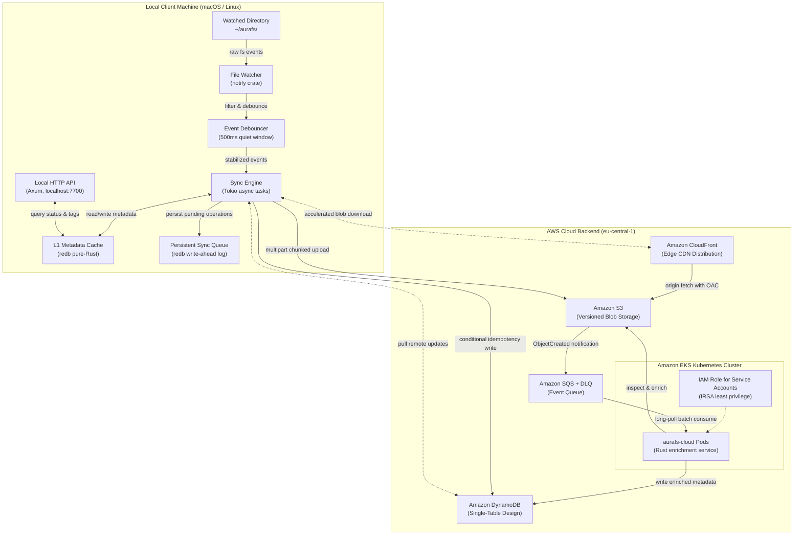

# AuraFS — Local-First Distributed File Synchronization Engine

[](https://github.com/yousef-usama/aurafs/actions/workflows/ci.yml)
[](LICENSE)
[](https://www.rust-lang.org)
[](https://www.terraform.io)
[](https://aws.amazon.com/eks/)

A high-performance, local-first background file synchronization daemon and cloud enrichment platform built entirely in Rust. AuraFS combines an embedded ACID key-value store, non-blocking asynchronous I/O, event debouncing, and an AWS cloud backend (S3, DynamoDB, CloudFront, EKS) to provide offline-capable bidirectional file synchronization without blocking user interactions.

---

## 1. System Architecture


<details>
<summary><strong>Expand Declarative Mermaid Architecture Diagram</strong></summary>



</details>

---

## 2. Tool Selection Rationale & Tradeoffs

| Component | Selected Technology | Alternative Evaluated | Selection Rationale & System Tradeoffs |
|---|---|---|---|
| **Core Systems Language** | **Rust (1.83+)** | Go / C++ | Zero-cost abstractions, fearless concurrency with `Send` + `Sync`, memory safety without a garbage-collector pause, and unified cross-target library compilation. Go's runtime GC introduces non-deterministic micro-pauses during high-throughput hashing; C++ lacks memory-safe compiler guarantees. |
| **Async Runtime** | **Tokio** | async-std / smol | Industry-standard work-stealing multithreaded scheduler. Native integration with AWS SDK for Rust and Axum. CPU-bound cryptographic operations are safely offloaded to `spawn_blocking` via bounded semaphores to prevent event-loop thread starvation. |
| **Embedded L1 Cache** | **redb** | SQLite (`rusqlite`) | Pure-Rust ACID key-value store with zero C dependencies or FFI boundary overhead. Simplifies cross-compilation and containerization. While SQLite provides relational queries, AuraFS access patterns are exclusively key-value lookups and sequential write-ahead queues. |
| **Local Web API** | **Axum** | Actix-web / Rocket | Native Tower ecosystem integration and direct shared Tokio runtime compatibility. Enables seamless non-blocking health checks, conflict inspections, and tag querying. |
| **Blob Storage** | **Amazon S3** | Cloudflare R2 / MinIO | Standard enterprise object storage with native S3 Event Notifications, byte-range multipart uploads, and lifecycle policies. |
| **State & Metadata** | **Amazon DynamoDB** | PostgreSQL (RDS) | Single-Table Design provides predictable single-digit millisecond latency at any scale with zero idle server maintenance and serverless on-demand billing. |
| **Edge Distribution** | **Amazon CloudFront** | Direct S3 Access | Origin Access Control (OAC) ensures private S3 buckets. Geographically distributed edge caching significantly reduces latency and bandwidth costs on cross-device pull synchronization. |
| **Cloud Compute** | **Amazon EKS** | ECS Fargate / Lambda | Native Kubernetes orchestration with Horizontal Pod Autoscaler (HPA), IRSA least-privilege security boundaries, and declarative GitOps readiness. |
| **IaC & Security** | **Terraform + Checkov** | Pulumi / CloudFormation | Declarative, modular infrastructure with Checkov static analysis automated in GitHub Actions to enforce enterprise security baselines on every pull request. |

---

## 3. Architecture & Tenancy Model

### Cargo Workspace Architecture

AuraFS adopts a multi-crate shared-library architecture mirroring modern platform engineering standards:

```text
aurafs/
├── aurafs-core/       # Shared library: data models, BLAKE3 hashing, DynamoDB schema, serialization
├── aurafs-daemon/     # Local daemon: notify file watcher, redb L1 cache, sync engine, Axum API
└── aurafs-cloud/      # Cloud service: SQS event consumer, MIME/EXIF enrichment, EKS health probes
```

- **`aurafs-core`**: Defines the single source of truth for types (`FileMetadata`, `SyncOperation`, `ConflictRecord`, `Tag`). Both binaries link directly to this crate, eliminating contract divergence between client and cloud.
- **`aurafs-daemon`**: Executes on the developer machine. It monitors `~/aurafs/`, maintains local state across network failures, and schedules background uploads without interrupting disk operations.
- **`aurafs-cloud`**: Runs in the `aurafs` Kubernetes namespace on EKS. It processes SQS event notifications, enriches metadata (content-type verification, image EXIF extraction), and records enriched attributes to DynamoDB.

### DynamoDB Single-Table Design

AuraFS metadata access patterns are handled by a single table using composite keys and Global Secondary Indexes (GSIs):

| Entity | Partition Key (`pk`) | Sort Key (`sk`) | `gsi1_pk` | `gsi1_sk` | Purpose |
|---|---|---|---|---|---|
| **File Metadata** | `FILE#<path>` | `#META` | — | — | Core file attributes, hash, size, and sync status |
| **Device Sync State** | `FILE#<path>` | `#DEVICE#<device_id>` | `DEVICE#<device_id>` | `<timestamp>` | Per-device sync tracking and timeline queries |
| **Directory Entry** | `DIR#<parent_dir>` | `F#<filename>` | — | — | O(1) directory listing queries |
| **Tag Mapping** | `FILE#<path>` | `#TAG#<key>` | `TAG#<key>=<value>` | `FILE#<path>` | Reverse lookup files by tag across devices |
| **Version History** | `FILE#<path>` | `#VERSION#<timestamp>` | — | — | Audit trail of file mutations across devices |

---

## 4. Production Incident Post-Mortems & Troubleshooting Log

### Incident 001: Cargo Workspace Manifest Validation Failure on Member Dependencies

- **Symptoms & Error**:
  ```text
  error: failed to load manifest for workspace member `/Users/Yousef/aurafs/aurafs-daemon`
  Caused by: no targets specified in the manifest.
  Either src/lib.rs, src/main.rs, a [lib] section, or [[bin]] section must be present
  ```
- **Root Cause Analysis (RCA)**:
  Cargo requires every member listed in the root `[workspace]` manifest to possess a valid entrypoint (`src/lib.rs` or `src/main.rs`) before compiling or running tests against any individual sibling crate (`aurafs-core`). Attempting to test `aurafs-core` before scaffolding binary entrypoints violated Cargo's workspace integrity check.
- **Resolution & Engineering Remediation**:
  Scaffolded minimal entrypoint files (`aurafs-daemon/src/main.rs` and `aurafs-cloud/src/main.rs`) initializing the Tokio runtime and tracing subscriber before running workspace-level verification commands.

---

### Incident 002: AWS OIDC Identity Provider Conflict on Pre-existing GitHub Provider

- **Symptoms & Error**:
  ```text
  Error: creating IAM OIDC Provider (token.actions.githubusercontent.com): EntityAlreadyExists:
  An OpenIDConnect Provider already exists for this URL
  ```
- **Root Cause Analysis (RCA)**:
  AWS accounts permit only one OIDC identity provider per unique URL (`https://token.actions.githubusercontent.com`). Because account `339712755065` had previously configured GitHub Actions OIDC for another workload, declaring `resource "aws_iam_openid_connect_provider"` failed on duplicate creation.
- **Resolution & Engineering Remediation**:
  Inspected existing providers via `aws iam list-open-id-connect-providers`, and replaced the resource declaration in `terraform/modules/iam/main.tf` with `data "aws_iam_openid_connect_provider" "github"`. This references the existing provider idempotently without state collisions.

---

### Incident 003: Homebrew Interactive Stdin Deadlock During Non-Interactive Installation

- **Symptoms & Error**:
  ```text
  ==> Upgrading go-task dependency: go (1.27.2 -> 1.27.3)
  ==> Do you want to proceed with the installation? [y/n]
  [Process hung waiting for stdin input]
  ```
- **Root Cause Analysis (RCA)**:
  When upgrading package dependencies on macOS, Homebrew prompts for interactive confirmation if run in an environment where terminal TTY attributes are attached, stalling automated background script execution.
- **Resolution & Engineering Remediation**:
  Delivered affirmative newline input to clear the prompt, and codified `HOMEBREW_NO_AUTO_UPDATE=1` and `NONINTERACTIVE=1` into automation scripts and developer workflows.

---

## 5. Cost Notes & Teardown Protocol

### Cost Optimization Architecture
- **S3 Lifecycle Rules**: Automatic expiration of non-current versions after 30 days and incomplete multipart uploads after 7 days prevents orphaned blob charges.
- **DynamoDB On-Demand Billing**: Zero baseline hourly or monthly capacity costs; billing scales strictly with request volume.
- **ECR Image Retention**: Automated lifecycle rule retains only the latest 10 images, bounding registry storage costs.
- **CloudFront Free Tier**: Origin Access Control and edge caching operate within the 1 TB/month AWS Free Tier allowance.
- **EKS Worker Node Sizing**: Single `t3.medium` instance configuration with Horizontal Pod Autoscaler (HPA) ensures minimal cluster footprint while demonstrating complete Kubernetes orchestration.

### Infrastructure Teardown Protocol
To prevent ongoing cluster and NAT Gateway charges when not actively demoing:

```bash
# Teardown all cloud infrastructure safely
task teardown
# Or directly via Terraform:
terraform -chdir=terraform destroy -auto-approve
```

---

## 6. Local Quickstart

### Prerequisites
- Rust 1.83+ (`curl --proto '=https' --tlsv1.2 -sSf https://sh.rustup.rs | sh`)
- Task runner (`brew install go-task`)
- Terraform 1.5+ (`brew install terraform`)
- Docker Desktop or OrbStack

### Developer Commands
```bash
# Verify environment and build workspace
task build

# Run unit and integration tests
task test

# Run code linters and security scanners
task lint

# Start the local synchronization daemon
task run-daemon
```
